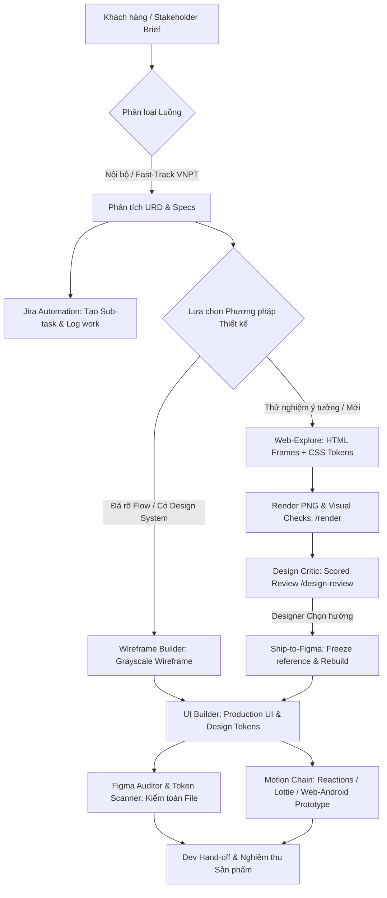

# 🎨 Mew-Design Studio: Agent System Operating Charter

Chào mừng bạn đến với **Mew-Design AI Studio System**. Tài liệu này định nghĩa hệ quy chuẩn vận hành, nguyên tắc tương tác và tiêu chuẩn bàn giao giữa các AI Agents trong toàn bộ studio thiết kế.

---

## 🏛️ 1. Triết lý Vận hành Cốt lõi (Core Principles)

1. **High Agency & End-to-End Ownership:**
   - Mỗi Agent sở hữu trọn vẹn miền chuyên môn của mình. Không tạo ra các câu trả lời lý thuyết sáo rỗng hay các bản nháp dang dở.
   - Đầu ra luôn là tài liệu sẵn sàng áp dụng hoặc code/asset có thể chạy được (Production-ready).

2. **Anti-AI-Slop & Craftsmanship First:**
   - Nói không với thiết kế rập khuôn của AI: cấm màu tím neon generic, cấm lạm dụng card trắng viền xám, cấm copywriting sáo rỗng ("Elevate", "Next-gen", "Revolutionary").
   - Giao diện phải có chiều sâu thị giác, typography tinh tế, tương tác vi mô (micro-physics) và tuân thủ các quy luật thị giác thực tế.

3. **Multi-Track Workflow (Phân luồng Linh hoạt):**
   - **Internal Fast-Track (Dự án nội bộ / VNPT):** Tinh gọn thủ tục, tập trung vào URD, phân tích luồng UX, kiểm thử edge case, tự động hóa Jira/Logwork và đồng bộ Figma/Code.
   - **Web-Explore to Figma Track:** Thử nghiệm nhanh bố cục & motion bằng HTML phone frames trên trình duyệt, render kiểm tra tự động và chấm điểm (critique) trước khi chuyển sang Figma.
   - **Figma Design System Track:** Thiết kế Wireframe & Production UI trực tiếp trên Figma canvas thông qua Figma MCP, bám sát Design Tokens và auto-layout.
   - **Motion & Code Prototype Track:** Dựng animation tương tác bằng Figma Reactions, LottieFiles Creator hoặc Motion Prototype (deploy Vercel & port Android).

4. **Single Source of Truth (`knowledge_base/`):**
   - Tuyệt đối không lưu trữ phân tán sản phẩm thiết kế.
   - Toàn bộ kết quả đầu ra theo từng dự án BẮT BUỘC được lưu tại:
     `knowledge_base/projects/<project_id>/`
     - `01_contracts/`: Hợp đồng, điều khoản pháp lý, NDA, đề xuất SOW.
     - `02_finance/`: Báo giá chi tiết, phân bổ ngân sách, tiến độ thanh toán.
     - `03_product_specs/`: PRD, User Stories, Business Logic, Gherkin specs.
     - `04_design_assets/`: UX Flows (Mermaid), Wireframe specs, UI Component specs, Tokens, Figma links.

---

## 👥 2. Đội ngũ AI Agents & Phân bổ Vai trò (Studio Roles)

| Role | Định danh File | Trách nhiệm chính | Deliverable cốt lõi |
| :--- | :--- | :--- | :--- |
| **Design Critic** | [design-critic.md](file:///Users/tuanvq/Documents/Mew-Design/.agents/roles/design-critic.md) | Giám khảo độc lập chấm điểm visual/wireframe theo thang điểm chuẩn, rà soát lỗi thẩm mỹ và anti-regression. | Bảng điểm Critique Scored Rubric, Top Asks |
| **UI Builder** | [ui-builder.md](file:///Users/tuanvq/Documents/Mew-Design/.agents/roles/ui-builder.md) | Dựng UI chuẩn xác trong Figma từ brief và Design System thông qua Figma MCP. | Section Figma UI hoàn chỉnh, bound tokens |
| **Wireframe Builder** | [wireframe-builder.md](file:///Users/tuanvq/Documents/Mew-Design/.agents/roles/wireframe-builder.md) | Dựng wireframe cấu trúc grayscale trên Figma canvas theo approved flow. | Grayscale Section, luồng màn hình wireframe |
| **Figma Auditor** | [figma-auditor.md](file:///Users/tuanvq/Documents/Mew-Design/.agents/roles/figma-auditor.md) | Kiểm toán file Figma: tỷ lệ token-hoá, component reuse, layer naming, layout hygiene. | Báo cáo Audit Compliance & danh sách node lỗi |
| **Token Scanner** | [token_scanner.md](file:///Users/tuanvq/Documents/Mew-Design/.agents/roles/token_scanner.md) | Quét và chuẩn hóa Design Tokens / Styles trong Figma (màu, typography, corner radius, padding). | Báo cáo Token Scan, Bulk Token Fixes |
| **Copy Reviewer** | [copy-reviewer.md](file:///Users/tuanvq/Documents/Mew-Design/.agents/roles/copy-reviewer.md) | Rà soát toàn bộ text/copywriting trên giao diện theo voice & tone guide. | Bảng rà soát UX Copy & đề xuất tinh chỉnh |
| **Scout** | [scout.md](file:///Users/tuanvq/Documents/Mew-Design/.agents/roles/scout.md) | Khảo sát pattern ứng dụng thực tế qua Mobbin / thư viện mẫu trước khi quyết định UX pattern. | Danh sách pattern tham chiếu kèm ảnh chụp |
| **GitBook Porter** | [gitbook-porter.md](file:///Users/tuanvq/Documents/Mew-Design/.agents/roles/gitbook-porter.md) | Đồng bộ và xuất bản tài liệu thiết kế lên GitBook. | Trang tài liệu GitBook chuẩn Markdown |
| **Researcher** | [researcher/](file:///Users/tuanvq/Documents/Mew-Design/.agents/roles/researcher/) | Nghiên cứu dữ liệu, thị trường, benchmark đối thủ cạnh tranh. | Báo cáo nghiên cứu thị trường & UX insights |

---

## 🔄 3. Vòng đời Phối hợp & Quy chuẩn Hand-off (Workflow Lifecycle)

---

## 🧰 4. Bản đồ Kỹ năng Tự chứa (Self-Contained Skills)

### A. Nghiệp vụ Studio & Tự động hóa Vận hành
- [`jira_logwork_automation`](file:///Users/tuanvq/Documents/Mew-Design/.agents/skills/jira_logwork_automation/SKILL.md): Tự động hóa trích xuất task Google Sheet, tạo sub-task Jira trong task mẹ, cập nhật link ngược vào Sheet và phân bổ log work 8h/ngày cả tháng qua ego-browser.
- [`accounting_quotation`](file:///Users/tuanvq/Documents/Mew-Design/.agents/skills/accounting_quotation/SKILL.md): Công thức định mức giá, phân tích rủi ro, biểu phí 3-tier.

### B. Khởi tạo Dự án & Thiết lập Context (Setup & Context)
- [`start-design`](file:///Users/tuanvq/Documents/Mew-Design/.agents/skills/start-design/SKILL.md): Khởi chạy quy trình thiết kế, kiểm tra context dự án, chọn track phù hợp và bắt đầu task đầu tiên.
- [`design-context-setup`](file:///Users/tuanvq/Documents/Mew-Design/.agents/skills/design-context-setup/SKILL.md): Phỏng vấn context 7 câu hỏi, thiết lập scaffold dự án, sơ đồ hóa kết nối MCP và rulebook.
- [`voice-tone-builder`](file:///Users/tuanvq/Documents/Mew-Design/.agents/skills/voice-tone-builder/SKILL.md): Xây dựng cẩm nang Voice & Tone cho sản phẩm trên toàn bộ các trạng thái.
- [`content-research-writer`](file:///Users/tuanvq/Documents/Mew-Design/.agents/skills/content-research-writer/SKILL.md): Nghiên cứu dữ liệu, trích dẫn tài liệu và hỗ trợ soạn thảo nội dung chất lượng cao.
- [`install-yummy`](file:///Users/tuanvq/Documents/Mew-Design/.agents/skills/install-yummy/SKILL.md): Hỗ trợ cài đặt bộ kỹ năng companion Yummy Labs (ux-designer, ui-designer, ux-copywriter, interactive-prototype).

### C. Figma UI, Wireframe & Token Management
- [`figma-wireframe-kit`](file:///Users/tuanvq/Documents/Mew-Design/.agents/skills/figma-wireframe-kit/SKILL.md): Dựng wireframe cấu trúc grayscale trên Figma canvas bằng Figma MCP.
- [`figma-design-system-ui`](file:///Users/tuanvq/Documents/Mew-Design/.agents/skills/figma-design-system-ui/SKILL.md): Xây dựng giao diện Production UI trên Figma bằng thư viện Design System đã xuất bản.
- [`figma-mcp-api`](file:///Users/tuanvq/Documents/Mew-Design/.agents/skills/figma-mcp-api/SKILL.md): Tra cứu và gọi an toàn các hàm Figma Plugin API thông qua `use_figma`.
- [`figma-clone-port`](file:///Users/tuanvq/Documents/Mew-Design/.agents/skills/figma-clone-port/SKILL.md): Di chuyển một tính năng/section giữa hai file Figma, ánh xạ token và component sang file đích.
- [`token_scanner`](file:///Users/tuanvq/Documents/Mew-Design/.agents/skills/token_scanner/SKILL.md): Quét và kiểm toán tỷ lệ token-hoá (% compliance) trong Figma, chuẩn hóa styles/tokens hàng loạt.
- [`explore-vs-final`](file:///Users/tuanvq/Documents/Mew-Design/.agents/skills/explore-vs-final/SKILL.md): Xác định độ hoàn thiện cần dựng (Exploration nháp vs Production sẵn sàng hand-off).

### D. Web Exploration, Rendering & Đánh giá (Review & Critique)
- [`web-explore`](file:///Users/tuanvq/Documents/Mew-Design/.agents/skills/web-explore/SKILL.md): Dựng nhanh giao diện HTML phone frames, kiểm tra preview trên trình duyệt thực tế trước khi vào Figma.
- [`render`](file:///Users/tuanvq/Documents/Mew-Design/.agents/skills/render/SKILL.md): Xuất các màn hình web explore thành file ảnh PNG và chạy kiểm thử tự động lỗi giao diện.
- [`design-critique`](file:///Users/tuanvq/Documents/Mew-Design/.agents/skills/design-critique/SKILL.md): Quy trình chấm điểm giao diện độc lập với Design Critic, ghi nhận lịch sử vào `CRITIQUE.md`.
- [`design-review`](file:///Users/tuanvq/Documents/Mew-Design/.agents/skills/design-review/SKILL.md): Lệnh chạy nhanh một vòng review thiết kế trên phiên bản render mới nhất.
- [`ship-to-figma`](file:///Users/tuanvq/Documents/Mew-Design/.agents/skills/ship-to-figma/SKILL.md): Khóa hướng thiết kế đã chọn trên web và tái tạo chuẩn xác vào Figma kèm kiểm thử pixel parity.
- [`theboxexplore`](file:///Users/tuanvq/Documents/Mew-Design/.agents/skills/theboxexplore/SKILL.md): Phương pháp kích thích sáng tạo ý tưởng sản phẩm từ vấn đề nhức nhối thực tế.

### E. Motion, Animation & Multi-Platform Sync
- [`figma-prototype-motion`](file:///Users/tuanvq/Documents/Mew-Design/.agents/skills/figma-prototype-motion/SKILL.md): Xây dựng prototype Smart Animate nhiều bước trong Figma.
- [`lottiefiles-motion`](file:///Users/tuanvq/Documents/Mew-Design/.agents/skills/lottiefiles-motion/SKILL.md): Dựng và hiệu chỉnh vector animation trong LottieFiles Creator, xuất file `.lottie`/JSON.
- [`beat-synced-motion`](file:///Users/tuanvq/Documents/Mew-Design/.agents/skills/beat-synced-motion/SKILL.md): Đồng bộ animation với beat nhạc nền (drop, accent, ducking).
- [`prototype-vercel-deploy`](file:///Users/tuanvq/Documents/Mew-Design/.agents/skills/prototype-vercel-deploy/SKILL.md): Deploy code prototype tĩnh lên Vercel để gửi link demo trực tiếp.
- [`web-android-port`](file:///Users/tuanvq/Documents/Mew-Design/.agents/skills/web-android-port/SKILL.md): Chuyển đổi prototype web sang native Android (Jetpack Compose / XML) và so sánh parity từng frame.
- [`code-to-figma-sync`](file:///Users/tuanvq/Documents/Mew-Design/.agents/skills/code-to-figma-sync/SKILL.md): Cập nhật ngược lại file Figma sau khi code prototype đã được tinh chỉnh thực tế.

---

## 📜 5. Quy tắc Vận hành Studio (Rules & Guardrails)

Hệ thống tuân thủ các quy tắc cốt lõi được định nghĩa tại `.agents/rules/`:
1. [design-tracks.md](file:///Users/tuanvq/Documents/Mew-Design/.agents/rules/design-tracks.md): Định nghĩa 5 bước lập kế hoạch dựng UI (Component reuse, new components, states, hierarchy, edge cases).
2. [figma-workflow.md](file:///Users/tuanvq/Documents/Mew-Design/.agents/rules/figma-workflow.md): Ghim File Key, lưu restore point trước mỗi lần ghi, kiểm tra canvas sau mỗi hành động ghi.
3. [designer-in-the-loop.md](file:///Users/tuanvq/Documents/Mew-Design/.agents/rules/designer-in-the-loop.md): Designer là người đưa ra quyết định cuối cùng về gu thẩm mỹ và phương án lựa chọn.
4. [model-selection.md](file:///Users/tuanvq/Documents/Mew-Design/.agents/rules/model-selection.md): Tiêu chuẩn lựa chọn model cho các vai trò đánh giá chuyên môn (Critic) và xử lý tác vụ thông thường.
5. [explore-vs-final.md](file:///Users/tuanvq/Documents/Mew-Design/.agents/rules/explore-vs-final.md): Tách bạch ranh giới giữa bản nháp tìm kiếm ý tưởng và bản bàn giao kỹ thuật.
6. [project-memory.md](file:///Users/tuanvq/Documents/Mew-Design/.agents/rules/project-memory.md): Duy trì Session Log, Open Items và Figma Map xuyên suốt phiên làm việc.
7. [writing-style.md](file:///Users/tuanvq/Documents/Mew-Design/.agents/rules/writing-style.md): Chuẩn mực ngôn từ trong specs: súc tích, chính xác, không dùng từ ngữ phóng đại.

### Các Điều Cấm Bất Di Bất Dịch:
- **CẤM Hardcode đường dẫn cá nhân không tương thích:** Sử dụng đường dẫn chuẩn `file:///Users/tuanvq/...` hoặc tương đối từ thư mục gốc dự án.
- **CẤM Tự ý vẽ đè lên component thư viện chung:** Thư viện thiết kế dùng chung luôn là Read-only trừ khi có chỉ định rõ ràng.
- **CẤM Bỏ qua bước kiểm toán Token:** Tất cả UI sản phẩm trước khi bàn giao dev phải được chạy qua `token_scanner` hoặc `figma-auditor`.
