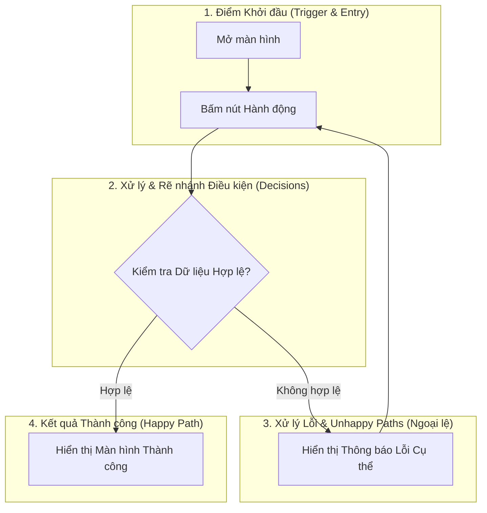

# Kỹ năng: Thiết kế Luồng UX & Copywriting (UX Flow Design)

## 📌 Tổng quan

Kỹ năng này cung cấp bộ công cụ và phương pháp luận cho UX Designer để xây dựng các sơ đồ luồng người dùng (User Flows) không tì vết bằng mã Mermaid, biên soạn văn phong tương tác (UX Writing) thấu cảm và bao bọc toàn bộ các kịch bản ngoại lệ (Edge Cases).

---

## 🛠️ Quy chuẩn Kỹ thuật Mermaid Flowchart

### 1. Cấu trúc Tiêu chuẩn của Sơ đồ Luồng
Luôn chia sơ đồ luồng theo 4 khối logic (Subgraphs) bằng cú pháp `flowchart TD`:


### 2. Quy tắc Bất di Bất dịch khi Viết Mermaid:
- **Quote nhãn nhạy cảm:** Bắt buộc bọc nhãn trong dấu ngoặc kép `["Nội dung"]` hoặc `{"Câu hỏi?"}` để tránh lỗi cú pháp dấu cách và ký tự đặc biệt.
- **Không có nhánh cụt:** Mọi trạng thái lỗi đều phải có đường dẫn người dùng quay lại điểm nhập hoặc có nút bấm điều hướng thoát/thử lại.
- **Phân biệt màu sắc trực quan:**
  - Nhánh Thành công dùng đường kẻ nét liền `-- "Thành công" -->`.
  - Nhánh Lỗi dùng nhãn cảnh báo rõ ràng `-- "Lỗi / Mất mạng" -->`.

---

## ✍️ Nguyên tắc UX Writing Thấu cảm (Empathy First)

| Yếu tố (Element) | Nguyên tắc Viết | Ví dụ Chuẩn (Good) | Ví dụ Sai (Bad) |
| :--- | :--- | :--- | :--- |
| **Tiêu đề (Header)** | Trực diện, nêu rõ người dùng đang ở đâu hoặc hành động cần làm | `Xác nhận thông tin đặt hàng` | `Thông tin` |
| **Nút bấm chính (CTA)** | Bắt đầu bằng Động từ hành động cụ thể + Danh từ | `Tiếp tục thanh toán` | `OK` / `Bấm vào đây` |
| **Thông báo lỗi (Error)** | 1. Nêu điều gì vừa xảy ra<br>2. Lý do vì sao<br>3. Cách khắc phục ngay | `Mã OTP không chính xác. Bạn còn 2 lần thử trước khi mã hết hiệu lực.` | `Lỗi hệ thống: Mã 403` / `Bạn đã nhập sai!` |
| **Trạng thái rỗng (Empty)** | Mô tả trạng thái + Gợi ý hành động đầu tiên | `Chưa có đơn hàng nào. Hãy khám phá các gói ưu đãi dành riêng cho bạn!` | `Không có dữ liệu` |

---

## 🛡️ Ma trận Ngoại lệ & Trạng thái Bắt buộc (4 Core States)

Trong tài liệu đặc tả UX, bắt buộc phải có mục kiểm soát 4 trạng thái:
1. **Ideal State:** Đầy đủ dữ liệu, hiển thị danh sách chuẩn đẹp.
2. **Empty State:** Dữ liệu trống. Phải có hình minh họa nhẹ, dòng text giải thích và 1 nút CTA khởi tạo.
3. **Loading / Skeleton:** Dùng khung xám động dạng pulse mô phỏng bố cục màn hình, không dùng vòng xoay spinner đơn điệu chiếm toàn màn hình.
4. **Offline / Error State:** Bị đứt kết nối mạng hoặc lỗi server. Phải có nút "Thử lại" (Retry).

---

## 📄 Mẫu Đặc tả UX Flow Hoàn chỉnh

```markdown
# UX Flow Specification: [Tên Tính năng]

- **Mã tính năng:** {FEATURE_CODE}
- **UX Designer:** {DESIGNER_NAME}
- **Lưu trữ:** `knowledge_base/projects/{PROJECT_CODE}/04_design_assets/UX_{FEATURE_CODE}.md`

## 1. Mục tiêu Luồng (User Flow Objective)
...

## 2. Sơ đồ Luồng Thao tác (Mermaid Flowchart)
\`\`\`mermaid
...
\`\`\`

## 3. Bảng UX Copywriting & Tương tác
| Vị trí / Element | Nội dung Text | Giọng điệu (Tone) | Hành vi / Ghi chú |
| :--- | :--- | :--- | :--- |
| Primary Button | Xác nhận kích hoạt | Rõ ràng, dứt khoát | Disable nếu chưa tích chọn điều khoản |
| Error Message | Số điện thoại chưa đúng định dạng | Nhẹ nhàng, hướng dẫn | Hiển thị màu đỏ cam dưới input field |

## 4. Xử lý Ngoại lệ (Edge Cases Checklist)
- [ ] Khi mạng chập chờn timeout > 10s: Hiện thông báo "Kết nối gián đoạn" + nút "Tải lại".
- [ ] Khi người dùng bấm nút 2 lần liên tiếp: Khóa nút sau lần chạm đầu tiên (Prevent Double Submit).
```
