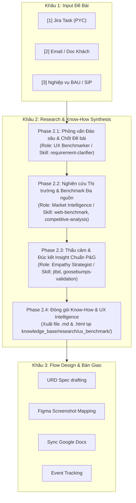

# Kế Hoạch Tối Ưu Hóa Khâu 2: Phân Tích, Đánh Giá, Research & Know-How Synthesis

Tài liệu này đề xuất phương án tái cấu trúc và làm mượt toàn bộ hệ thống **Roles (Vai trò)**, **Skills (Kỹ năng chuyên sâu)**, và **Workflows (Quy trình tự động hóa)** phục vụ cho **Khâu 2 (Research & Know-How Synthesis)** của Mew-Design OS, kết nối liền mạch từ Khâu 1 (Lead Intake & SOW) sang Khâu 3 (Flow Design, URD & Figma Mapping).

---

## 🎯 1. Mục Tiêu Cốt Lõi (Objectives)

1. **Chuẩn hóa Roles:** Định hình rõ ranh giới trách nhiệm, input/output, và bộ skill gắn kèm của từng chuyên gia AI trong Khâu 2.
2. **Làm mượt Bộ Skills:** Nâng cấp các kỹ năng nghiên cứu (`web-benchmark`, `jtbd-analysis`, `ethnographic-research`, `goosebumps-validation`, bổ sung `competitive-analysis` & `knowhow-synthesizer`) với format output chuẩn, template trực quan, có bằng chứng thực tế (URL, hình ảnh, case study).
3. **Tối ưu hóa Master Workflow:** Hoàn thiện luồng tổng thể `start_flow_design.md` cùng các quy trình con (`PYC_execute_workflow.md`, `email_execute_workflow.md`, `BAU_SIP_execute_workflow.md`), tự động lưu tài liệu vào đúng cấu trúc `knowledge_base/research/` và xuất cả bản Markdown lẫn bản HTML tương tác đẹp mắt.

---

## 🏗️ 2. Kiến Trúc Khâu 2 (4 Giai Đoạn Logic)

---

## 📋 3. Chi Tiết Đề Xuất Thay Đổi

### A. Hệ Thống Roles (`.agents/roles/flow design/`)

| Role | Tên vai trò | Trách nhiệm chính | Skills sử dụng | Deliverable Output |
| :--- | :--- | :--- | :--- | :--- |
| **`ux_benchmarker.md`** | Chuyên gia Benchmark & Khảo sát Đề bài | Đặt câu hỏi bóc tách Painpoint/Goal/JTBD; Quét web tìm giải pháp thị trường, case study, video, UI flows | `web_benchmark`, `requirement_clarifier`, `browser` | Đề bài chuẩn hóa & Báo cáo Benchmark thị trường |
| **`pg_ux_researcher.md`** | Chuyên gia Thấu cảm Người dùng | Đào sâu bối cảnh thực tế, hành vi bù trừ (workaround), phát biểu tối đa 3 JTBD cô đọng | `ethnographic_research`, `jtbd_analysis` | `RS[ID]_[Tên_Task]_insight.md` |
| **`empathy_strategist.md`** | Chiến lược gia Trải nghiệm (Gác cổng P&G) | Ghép nối Nỗi đau - Lợi ích; Kiểm định Goosebumps Test (Tính Người, Tính Vượt trội, Chạm Cảm xúc); Phác thảo Blueprint Logic + Emotion | `goosebumps_validation`, `problem_solution_mapping` | `empathy_strategy_blueprint.md` |
| **`knowhow_synthesizer.md`** *(Mới)* | Kiến trúc sư Tri thức & Trình bày | Tổng hợp toàn bộ dữ liệu từ 3 role trên, chuẩn hóa cấu trúc 5 phần, xuất bản Markdown + HTML visual dashboard vào Knowledge Base | `knowhow_packaging`, `html_presentation_builder` | `UXB_[ID]_[Tên_tính_năng].md` & `.html` |

---

### B. Hệ Thống Skills (`.agents/skills/flow design/`)

1. **[MODIFY] `web_benchmark.md`:**
   - Cập nhật quy chuẩn tìm kiếm 3 nhóm tư liệu: (1) Bài viết/Case Study phân tích sâu (Medium, NN/g, UX Collective), (2) Video Motion/Demo (Youtube, Tiktok), (3) UI Screens & Micro-flows (Mobbin, Behance, Dribbble, App Store).
   - Chuẩn hóa cấu trúc thu thập: Tối thiểu 3, tối đa 8 examples chất lượng cao có đính kèm Screenshot / Video Link / Key Takeaway.
2. **[MODIFY] `goosebumps_validation.md`:**
   - Bổ sung thang đo 3 bậc chuẩn P&G: Human-Centricity (Nghe có giống người thật?), Superiority (Vượt trội rõ rệt cách cũ?), Emotional Resonance (Có chạm cảm xúc sâu nhất?).
   - Cơ chế Reject / Refine: Nếu ý tưởng "app nào cũng làm vậy" -> buộc làm lại để tạo điểm chạm độc bản.
3. **[MODIFY] `jtbd_analysis.md` & `ethnographic_research.md`:**
   - Làm mượt công thức JTBD: "Khi [Bối cảnh/Tình huống] -> Tôi muốn [Động lực/Hành động] -> Để tôi có thể [Giá trị/Cảm xúc đạt được]".
   - Tối đa 3 JTBD cốt lõi cho một bài toán để tránh loãng phạm vi.
4. **[NEW] `competitive_matrix.md`:**
   - Skill tạo bảng ma trận so sánh tính năng (Feature Comparison Matrix) giữa VNPT / My VNPT với các app hàng đầu (Viettel Money, MoMo, Techcombank, Shopee, Grab, Revolut...).
5. **[NEW] `knowhow_packaging.md`:**
   - Skill đóng gói tài liệu nghiên cứu thành file Markdown chuẩn + tự động render file HTML với giao diện hiện đại (dark/light theme, tag badges, collapsible sections, responsive cards, preview links).

---

### C. Hệ Thống Workflows (`.agents/workflows/Flow design/`)

1. **[MODIFY] `start_flow_design.md`:**
   - Làm mượt Master Menu điều hướng 3 nguồn:
     - `[1] PYC Jira`: Chạy `PYC_execute_workflow.md`
     - `[2] Email / Doc`: Chạy `email_execute_workflow.md`
     - `[3] Khảo sát BAU/SIP`: Chạy `BAU_SIP_execute_workflow.md`
   - Đảm bảo các đường dẫn file và thư mục trỏ chính xác về `knowledge_base/research/ux_benchmark/`.
2. **[NEW] `PYC_execute_workflow.md`:**
   - Quy trình khép kín xử lý bài toán từ Jira: Lấy thông tin task -> Bóc tách yêu cầu -> Benchmark tính năng tương đương -> Chấm điểm Goosebumps -> Xuất hồ sơ UX Benchmark.
3. **[NEW] `email_execute_workflow.md`:**
   - Quy trình xử lý yêu cầu từ email/văn bản/link Drive của khách hàng hoặc sếp.
4. **[NEW] `BAU_SIP_execute_workflow.md`:**
   - Quy trình khảo sát và nghiên cứu từ con số 0 cho các tính năng nghiệp vụ nội bộ (phỏng vấn đề bài đa chiều trước khi benchmark).
5. **[MODIFY] `ux_benchmark_research.md`:**
   - Sửa toàn bộ các đường dẫn lưu file cũ sang đường dẫn chuẩn trong workspace: `/Users/tuanvq/Documents/Mew-Design/knowledge_base/research/ux_benchmark/`.

---

## 🔍 4. Kế Hoạch Xác Minh & Kiểm Thử (Verification Plan)

### Kịch Bản Test Thực Tế:
1. **Test Luồng 1 (Jira PYC):** Kích hoạt `/start_flow_design` -> Chọn `1` -> Đưa vào 1 case Jira thực tế (ví dụ: `[IT360-1587543] Nâng cấp luồng Đăng ký Gói cước / Đổi SIM`) -> Kiểm tra xem AI có tự động:
   - Phỏng vấn làm rõ nếu thiếu context.
   - Quét Web tìm 3-5 case study & video tham khảo (Mobbin/Youtube).
   - Đúc kết JTBD và chạy Goosebumps Test.
   - Xuất file `.md` và `.html` tại `knowledge_base/research/ux_benchmark/`.
2. **Test Luồng 2 (Email / Brief):** Kích hoạt `/start_flow_design` -> Chọn `2` -> Dán brief từ khách hàng Zalo/WhatsApp -> Đánh giá độ mượt của báo cáo Know-How đầu ra.
3. **Test Hiển Thị Visual:** Mở file HTML vừa tạo trên trình duyệt để xác nhận giao diện đẹp mắt, dễ đọc, sẵn sàng chia sẻ cho Team/Sếp/Khách hàng.
