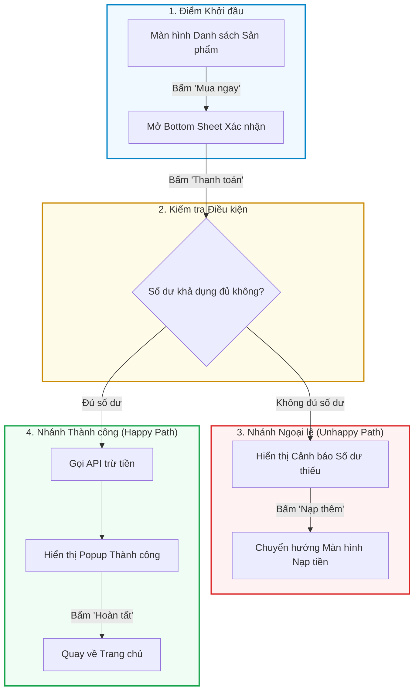

# Đặc tả Luồng Trải nghiệm Người dùng (UX Flow Specification)

> **Dự án:** `{PROJECT_NAME}` | **Tính năng:** `{FEATURE_NAME}` | **Mã Spec:** `UX-{FEATURE_CODE}`  
> **UX Designer:** `{DESIGNER_NAME}` | **Ngày tạo:** `{YYYY-MM-DD}` | **Phiên bản:** `v1.0`  
> **Tài liệu tham chiếu:** [PRD liên quan](../03_product_specs/PRD_{PROJECT_CODE}.md)

---

## 1. Mục tiêu & Hành vi Cốt lõi (Goal & User Intent)
- **Mục tiêu người dùng:** Người dùng muốn đạt được kết quả gì thông qua luồng này?
- **Nguyên tắc trải nghiệm:** Nhanh gọn, giảm tải nhận thức (Cognitive Load), thông báo rõ ràng.

---

## 2. Sơ đồ Luồng Trực quan (Mermaid User Flow)

---

## 3. Bảng UX Copywriting & Tương tác (Micro-copy Matrix)

| Vị trí / Thành phần | Nội dung Chữ (Copywriting) | Giọng điệu (Tone) | Quy tắc Tương tác (Interaction Rule) |
| :--- | :--- | :--- | :--- |
| **Tiêu đề Màn hình (Header)** | `Xác nhận Đặt hàng` | Rõ ràng, trang trọng | Cố định ở đầu màn hình khi cuộn |
| **Nút hành động chính (Primary CTA)** | `Thanh toán ngay • 150.000đ` | Dứt khoát, minh bạch | Hiển thị spinner khi đang gọi API |
| **Nút hành động phụ (Secondary CTA)** | `Để sau` | Nhẹ nhàng, không ép buộc | Đóng popup và lưu tạm vào giỏ hàng |
| **Thông báo lỗi (Error Toast)** | `Không thể kết nối máy chủ. Vui lòng kiểm tra mạng và thử lại.` | Thấu cảm, hướng dẫn | Tự động ẩn sau 4 giây hoặc bấm nút 'Thử lại' |
| **Ghi chú bảo mật (Sub-copy)** | `Giao dịch được bảo mật bởi chuẩn PCI-DSS 256-bit.` | Tin cậy, an tâm | Font chữ nhỏ hơn (12px), màu trung tính |

---

## 4. Ma trận Đặc tả 4 Trạng thái (4 Core States Heuristics)

### 4.1. Ideal State (Trạng thái Lý tưởng)
- Hiển thị đầy đủ danh sách thông tin đơn hàng, số tiền, phương thức thanh toán đã chọn mặc định.

### 4.2. Empty State (Trạng thái Rỗng)
- Khi giỏ hàng chưa có sản phẩm: Hiển thị hình minh họa túi mua sắm rỗng, dòng chữ: `"Giỏ hàng của bạn đang trống. Khám phá các ưu đãi đặc quyền ngay hôm nay!"` và 1 nút Primary CTA: `"Khám phá ngay"`.

### 4.3. Loading / Skeleton State (Trạng thái Đang tải)
- Khi đang tải dữ liệu đơn hàng: Áp dụng hiệu ứng xám động Skeleton Pulse mô phỏng bố cục thẻ thanh toán. Tuyệt đối không dùng màn hình đen hoặc spinner che khuất.

### 4.4. Error / Offline State (Trạng thái Sự cố Mạng)
- Khi người dùng mất kết nối Internet: Hiển thị banner phía trên: `"Đang mất kết nối mạng. Các thay đổi sẽ được đồng bộ khi có kết nối trở lại."`

---

## 5. Danh mục Kiểm tra Ngoại lệ (Edge Cases Checklist)
- [ ] **Thao tác nhanh / Double-tap:** Đã vô hiệu hóa (disabled) nút bấm ngay sau lần click đầu tiên để tránh gửi 2 request trừ tiền cùng lúc.
- [ ] **Màn hình xoay ngang / Font chữ cỡ lớn:** Layout tự động co giãn không bị cắt mất nút thanh toán khi người dùng bật cỡ chữ Accessibility lớn nhất trên iOS/Android.
- [ ] **Hết hạn phiên đăng nhập (Token Expired):** Tự động lưu lại trạng thái giỏ hàng hiện tại, đưa ra popup đăng nhập lại mà không làm mất thông tin người dùng đã chọn.
